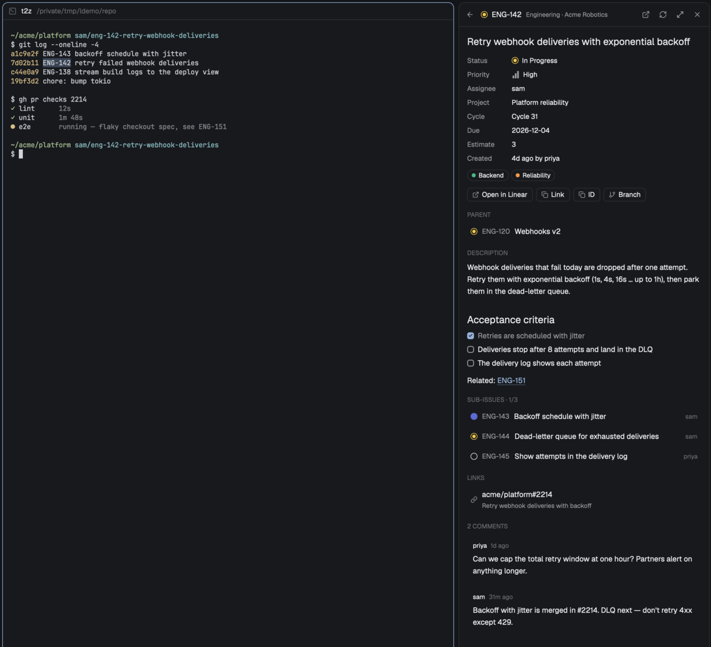
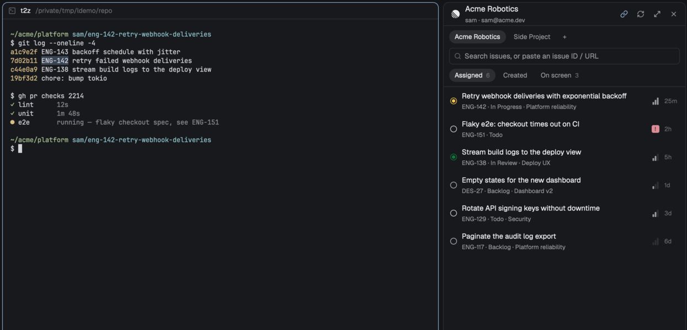

# Linear panel for the Herdr desktop app

A side panel for [Herdr](https://herdr.dev)'s desktop app (`herdr-app`): your Linear issues
beside your terminals, in the right workspace for the repo you're in.





*Screenshots use made-up demo workspaces.* To build the mod from scratch, see
[RECIPE.md](RECIPE.md).

- **Lists:** Assigned, Created, On screen (issues the focused terminal mentions), and search.
  Typing `ENG-12` or an issue URL in the search box opens that issue.
- **Issues in full:** status, priority, assignee, project, cycle, labels, parent, description,
  sub-issues, linked PRs and comments, with Open in Linear (browser) and copy link / ID /
  branch name.
- **Terminal links:** select an issue code in any terminal (double-click `ENG-12`, or
  triple-click a line holding one) and the panel opens it. The link button in the panel
  header turns this off.
- **Several workspaces:** connect each one with **+**. The lists follow the focused
  terminal's repo: the workspace remembered for it, else the one whose team keys appear in
  its branch name or output (then remembered), else the last one used. Picking a workspace
  chip remembers it for that repo; every worktree of a repo shares the choice. Issue links
  and codes always open in the workspace they belong to.

## Install

```sh
# the Rust bridge, to ~/.local/bin/herdr-linear-gui (needs Rust's cargo)
cargo install --force --git https://github.com/far-fetched-labs/herdr-linear --features gui --bin herdr-linear-gui --root ~/.local
# this mod, into ~/.config/herdr-app/mods/linear (Herdr loads it by itself)
mkdir -p ~/.config/herdr-app/mods && cp -R herdr-app/mods/linear ~/.config/herdr-app/mods/
```

From a clone with [just](https://github.com/casey/just): `just install-gui` and `just install-mod`.

Then add a toggle and the panel to your layout (`~/.config/herdr-app/layouts/<yours>.json`).
The toggle goes in a row beside your tab bar; the panel is a hidden column beside the block
that shows the active tab:

```json
{ "id": "linear-toggle", "type": "block", "size": { "px": 88 },
  "content": { "mod": "linear", "props": { "role": "toggle" } } }
```

```json
{ "id": "linear-panel", "type": "column", "size": { "px": 440 }, "min": 320, "max": 2400, "hidden": true,
  "children": [ { "id": "linear", "type": "block", "content": { "mod": "linear" } } ] }
```

The toggle shows and hides the node with id `linear-panel` (`layout.toggle`), so keep that
id. Open the panel and click **Connect with Linear**: your browser asks Linear for access
(read and write), and the panel shows the workspace once you approve. **Use an API key**
instead opens a terminal that asks for a personal API key.

## Watch out

- The panel reads terminal selections from the system clipboard (`pbpaste`), so selection
  links need Herdr's `copy_on_select` (on by default) and macOS.
- Herdr's own Cmd-click on a `linear.app` URL still opens the browser: mods can't intercept
  terminal link clicks.
- The bridge runs on this computer even for spaces on other machines.

Icons: [Lucide](https://lucide.dev) (ISC), and the Linear mark from
[Simple Icons](https://simpleicons.org) (CC0).

## Notice

The Branch, All, comments, actions, worktree and settings features are adapted from
[Branch Issue](https://github.com/munza/herdr-mods), Copyright 2026 Tawsif Aqib, Apache-2.0.
Adapted files carry that attribution in their header.
