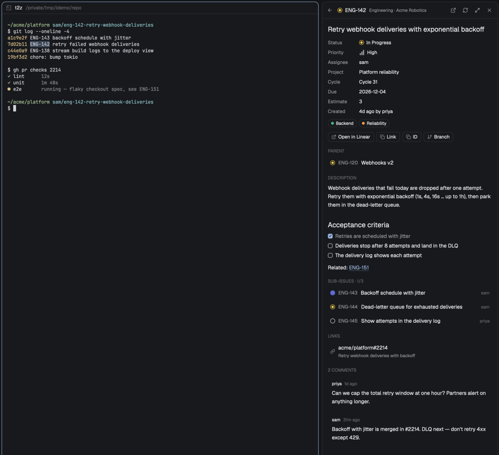

# Linear

A Linear side panel beside your terminals. It lists your open issues, searches them, collects
the issues the focused terminal mentions, and shows any issue in full: description, sub-issues,
linked PRs and comments, with Open in Linear for the browser. Select an issue code in any
terminal (double-click `ENG-142`) and the panel opens that issue. It connects any number of
Linear workspaces and shows the right one for the repo you're in.

## What you see

- **Tab-bar toggle** (an 88 px block in the row beside the tabs): a 26 px pill with the Linear
  mark (13 px), "Linear", and your open-issue count in `dim` at 11 px. Its background is
  `selected` while the panel shows and `chrome` otherwise; the bar under it is `chrome` with a
  1 px `border` bottom edge.
- **Panel** (a column 440 px wide, min 320, max 2400; hidden until toggled). It's a card with a
  10 px radius, `background` fill and a 1 px `border`, at the `ui_font_size` setting (13 px if
  unset). From top to bottom:
  - **Header**, 42 px: the Linear mark (15 px), then the workspace name (semibold, +1 px) over
    "name · email" in `muted`. Then four 26 px icon buttons:
    - the link toggle, in `accent` while on: selecting an ID in a terminal opens it;
    - refresh, which spins while anything loads;
    - expand/shrink;
    - hide.
  - **Workspace chips**: one 24 px pill per connected workspace (radius 12, `selected` when
    shown), with a `blocked`-colored dot when that workspace needs signing in again. Then a
    "+" pill, which reads "Connect" when nothing is connected and "Waiting for browser…" with a
    spinner during sign-in.
  - **Search box**, 30 px, on `surface`: "Search issues, or paste an issue ID / URL".
  - **View chips** with counts: Assigned, Created, On screen, plus Search once a search has run.
  - **List rows**:
    - a 12 px status ring in the state's own Linear color: empty for backlog/todo, a dot inside
      when started, filled when done, `dim` when canceled;
    - the title, over "ID · state · project" in `muted` at −2 px (other lists add the assignee);
    - a 14 px priority mark: three bars lit in `muted` for High, two for Medium, one for Low; a
      red (`ansi1`) "!" square for Urgent;
    - the age ("now", 25m, 5h, 3d, 2mo) in `dim`.
    Rows from another workspace (On screen) carry a small workspace tag.
- **Issue view** (replaces the list):
  - A header with back, status ring, ID, and "team · workspace". Then Open in browser,
    refresh, expand and hide.
  - The title at +4 px, then a fact table (70 px labels in `muted`): Status, Priority,
    Assignee, Project, Cycle, Due, Estimate, Created. Labels follow as pills with their color
    dot.
  - Buttons: Open in Linear, and copy Link, ID or Branch.
  - Sections under small uppercase `dim` headings: Parent, Description (markdown), Sub-issues
    "done/total", Links (attachments such as PRs), and Comments (cards on `surface`; replies
    indented 16 px).
- **Not connected**: "Connect Linear" with **Connect with Linear** and **Use an API key**.
  **Bridge missing**: "Install the Linear bridge", the exact `cargo install` command, and
  **Build and install** and **Retry** buttons.

## How it behaves

- **Toggle**: clicking it runs `layout.toggle` on `linear-panel`. Hide runs `layout.hide`.
  Expand runs `layout.resize` to weight 3, and shrink restores the remembered px width.
- **Lists**:
  - Assigned and Created are open issues (not completed or canceled), newest update first, up
    to 100.
  - They refresh every 60 s while the panel shows and every 5 min while hidden, which keeps the
    toggle's count current.
  - The last list shows instantly on start from local storage.
- **Search**: Enter runs a Linear search (30 results). An issue ID or `linear.app/…/issue/…` URL
  opens that issue instead. Clearing the box goes back to Assigned.
- **On screen**:
  - Every 4 s while shown, it reads the focused terminal's screen and last 400 lines
    (`hc read`).
  - It finds identifiers for the connected teams' keys, in any case (so branch names count),
    plus any Linear issue URL, newest mention first, up to 40.
  - It fetches their titles in one request per workspace.
- **Terminal links**:
  - The toggle (always shown, so it works with the panel hidden) watches `focused().selection`.
  - When a selection holds still for 250 ms, it reads the clipboard (`pbpaste`), which Herdr's
    copy-on-select has filled.
  - If the text holds exactly one issue reference and is under 400 characters, it shows the
    panel and opens that issue. A stale clipboard is ignored: the text must have changed since
    the last check, or exactly match a one-row selection's width.
  - A selected URL is passed whole, so it opens in its own workspace.
- **Workspaces**:
  - Each one is connected through Linear OAuth in the browser (**+** or Connect), or with an
    API key typed into a terminal (**Use an API key**). A successful connect shows the new
    workspace and remembers it for the current repo.
  - The lists follow the focused terminal's repo, keyed by machine plus git common dir, so
    every worktree shares it. The panel shows the workspace remembered for that repo. If none
    is remembered, it picks the one whose team keys are in the branch name, then the one the
    terminal mentions most, and remembers it. Otherwise it stays on the last one used.
  - Clicking a chip shows that workspace and remembers it for the repo.
  - Issue links and IDs always open in the workspace that owns them, whatever the lists show.
- **Issue view**:
  - Rows, parent, sub-issues and Linear links in descriptions and comments open in the panel;
    back walks the trail. Other links open in the browser (`open`).
  - An issue is fetched again when shown after 30 s.
- **Errors**:
  - A workspace whose sign-in expired shows "Reconnect <name>" in place of its lists.
  - A failed connect stays in the panel in `ansi1` and as a toast.
  - Network errors show above the list, which keeps the last data.

## Built from

- **Layout**: a toggle block in the tab row and a hidden column `linear-panel` beside the
  `{ "tab": "active" }` block:
  - `{ "id": "linear-toggle", "type": "block", "size": { "px": 88 }, "content": { "mod": "linear", "props": { "role": "toggle" } } }`
  - `{ "id": "linear-panel", "type": "column", "size": { "px": 440 }, "min": 320, "max": 2400, "hidden": true, "children": [ { "id": "linear", "type": "block", "content": { "mod": "linear" } } ] }`
- **Mod `linear`**: `mods/linear/main.js` holds the panel, plus the toggle for `props.role ===
  "toggle"`. `linear.js` wraps the bridge and finds references. `mod.json` is
  `{ "place": "none", "title": "Linear" }`. `icons/` holds Lucide glyphs and the Linear mark.
- **herdr**:
  - `exec`, `hc` (`read <terminal> --lines 400`), `focused` (cwd, terminal, selection),
    `spaces` (machine), `layout`, `theme`, `settings`;
  - `shared`/`setShared`:
    - `linear.teams`: the connected team keys, for the toggle;
    - `linear.count`: the toggle's count;
    - `linear.open`: `{id, q, at}`, a request to open an issue;
    - `linear.autoOpen`: the link toggle;
  - `notify`, `run` (`layout.toggle`/`show`/`hide`/`resize`, `pane.split` for the API-key and
    install terminals), `localStorage`.
- **Programs**:
  - `herdr-linear-gui`, a Rust bridge at `~/.local/bin`. It runs one subcommand per request
    and prints one JSON document: `workspaces`, `list assigned|created -w <ws>`,
    `search <text> -w <ws>`, `issue <ref> [-w <ws>]`, `lookup <ref>…`, `login`,
    `login --key`. Exit code 2 means connect or reconnect.
  - `pbpaste`, `git rev-parse --path-format=absolute --git-common-dir --abbrev-ref HEAD`, `open`.
- **Network and files**: the bridge calls `api.linear.app` and keeps credentials in
  `~/.config/herdr-linear/accounts.json` (0600). Sign-in is OAuth with PKCE through the public
  "Herdr Issues" app; Linear redirects back to `http://127.0.0.1:47821/callback`. The mod
  itself reads no files outside its folder.

## Watch out

- Mods can't intercept terminal link clicks. Herdr's own Cmd-click on a URL always opens the
  browser, which is why links work by selection.
- Selection links need copy-on-select (Herdr's default) and macOS (`pbpaste`). A programmatic
  `terminal.select` doesn't copy.
- `exec` calls `herdr-linear-gui` by absolute path, `~/.local/bin/herdr-linear-gui`, since
  Herdr's PATH may not include `~/.local/bin`.
- `login` holds port 47821 for up to 5 minutes, waiting for the browser. A second sign-in in
  that time fails with "can't listen on 127.0.0.1:47821".
- Bare identifiers match only connected teams' keys, so `UTF-8` is never a link. A key that two
  workspaces share goes to the workspace shown, else to the first.
- Linear search allows 30 requests a minute.
- The bridge always runs on this computer, even for spaces on other machines; Linear and the
  credentials are the same from everywhere.
- Never keep a `cx`: every timer, spawn and click uses its own. Render only compares the
  focused folder and spawns git when it changes.

## Done when

- `herdr-app check mods/linear` passes.
- The toggle shows and hides the panel and shows the Assigned count.
- With nothing connected, Connect with Linear opens the browser; after you approve, the
  workspace's chip and Assigned list appear.
- With two workspaces connected, a repo whose branch carries one workspace's team key shows
  that workspace's lists, and returning to the repo later still shows it.
- Double-clicking an issue ID in a terminal opens it in the panel, even while the panel is
  hidden, and in the right workspace.
- On screen lists the issues the focused terminal mentions.
- Open in Linear opens the issue's URL in the browser.
